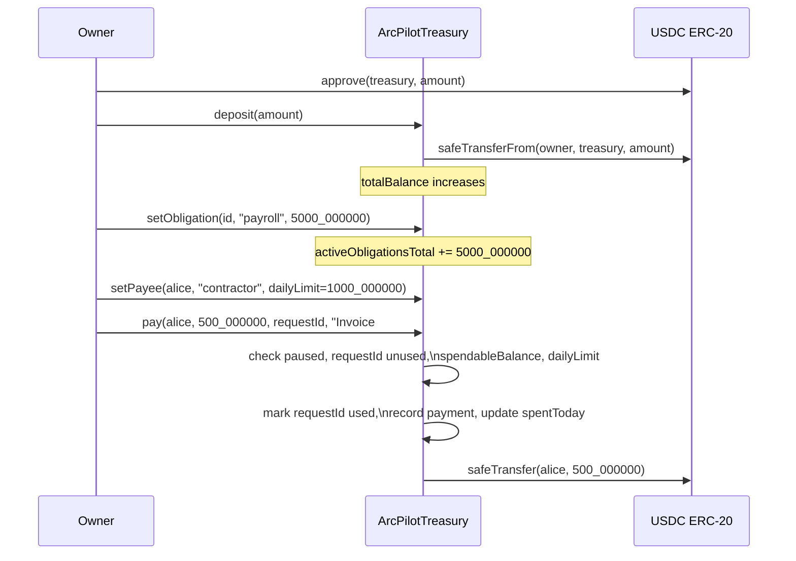

# ArcPilotTreasury — Smart Contract Design Document

**Status:** Draft  
**Authors:** ArcPilot team  
**Target chain:** Arc Testnet (chain ID 5042002) → Arc Mainnet (chain ID 5042)  
**Language / Toolchain:** Solidity 0.8.20, Foundry (forge 1.7+), OpenZeppelin 5.1.x  
**Milestone:** Hackathon submission (Arc Microgrants 2)  

**Review tracker**

| Review | Owner | Status |
|---|---|---|
| Design | TBD | [ ] Open |
| Security | TBD | [ ] Open |
| Ops | TBD | [ ] Open |

---

## Action Items (living)

_Empty at draft. Populate after each review round._

---

## 1. Goals / Non-Goals

### Goals

- Hold USDC on behalf of an organisation and enforce a spending policy before every transfer out.
- Allow the owner to configure a minimum reserve (basis-point fraction of balance), named recurring obligations (payroll, rent, SaaS), and a per-recipient allowlist with per-recipient and global daily caps.
- Allow the owner to submit payment requests identified by a unique, caller-supplied request ID; the contract records and deduplicates on that ID so duplicate submissions are idempotent reverts rather than double-spends.
- Emit a complete, indexed, onchain audit trail: every policy change, every payment, every deposit and withdrawal.
- Provide an emergency pause by a dedicated Pauser role (not the owner) that halts all fund movement without transferring custody.
- Provide a Rescuer role that can recover mistakenly sent ERC-20 tokens other than the configured USDC token.
- Use only standard OpenZeppelin primitives; no custom cryptography, no upgradeability.

### Non-Goals

- **Not upgradeable.** Any bug fix requires redeployment and migration. This is explicit.
- **Not a multisig.** The Owner role is a single address; using a multisig is an operational decision, not an in-contract one.
- **Not cross-chain.** No CCTP, no bridging, no cross-chain message-passing.
- **Not a yield or lending protocol.** Funds at rest do nothing.
- **Not a general ERC-20 vault.** The token is fixed at deploy and cannot be changed.
- **Not responsible for off-chain invoice matching.** The contract stores a `requestId` and a `memo`; matching them to real invoices is an off-chain concern.
- **Not an on-chain payroll scheduler.** Obligations are stored caps, not auto-executed transfers.

---

## 2. Requirements

### Functional

1. Anyone may deposit USDC (they must have pre-approved the contract).
2. Only the Owner may set/remove obligations, set/remove payees, change `reserveBps`, execute payments, and withdraw.
3. `spendableBalance = totalBalance − obligations − reserve`, floored at zero.
4. `reserve = floor(totalBalance × reserveBps / 10000)` — integer arithmetic only, no floating point.
5. A payment reverts if `amount > spendableBalance` at execution time.
6. A payment reverts if the daily per-payee limit would be exceeded (rolling 24-hour window keyed to `block.timestamp`).
7. A payment reverts if the global daily limit would be exceeded (same window, all payees combined).
8. A per-transaction maximum (`maxTxAmount`) caps a single payment regardless of limits.
9. Every payment carries a caller-supplied `requestId`; the contract marks it `used` and reverts on any second submission with the same ID.
10. Pause halts: `pay`, `withdraw`, `deposit`. Pause does not affect reads.
11. Unpause restores normal operation.
12. Rescuer can recover any ERC-20 token **except** `usdc`; it cannot rescue native coin (Arc = USDC so no native rescue path needed).
13. Ownership transfer is two-step (request + accept).

### Security (testable assertions)

- S1: `spendableBalance()` never returns a value that would cause `usdc.balanceOf(address(this))` to drop below `obligations + reserve` after a transfer.
- S2: No path executes a second payment with a previously-used `requestId`.
- S3: A non-Owner, non-Pauser, non-Rescuer address cannot alter state.
- S4: `activeObligationsTotal` equals the arithmetic sum of `amount` for all obligations where `active == true` at all times.
- S5: `reserveAmount() <= totalBalance()` at all times.
- S6: Pausing always prevents fund movement regardless of caller.
- S7: `usdc.safeTransfer` is the only outbound token transfer path.
- S8: `rescueToken` reverts when called with the `usdc` address.

---

## 3. Terminology & Actors

### Terms

| Term | Definition |
|---|---|
| **USDC** | The ERC-20 stablecoin configured at deploy. On Arc, address `0x3600000000000000000000000000000000000000`, 6 decimals. **[MANUAL VERIFY: confirm address and decimals at https://docs.arc.io before mainnet deploy.]** |
| **Obligation** | A named, owner-configured spending commitment (e.g. "payroll", "hosting") stored as an integer USDC amount in the contract's base units. It is a *cap*, not a scheduled transfer. |
| **Invoice / Payment Request** | A real-world invoice matched off-chain to a payment request submitted by the owner. The contract stores the caller-supplied `requestId` and `memo` for audit; it does not validate the off-chain document. |
| **Reserve** | `floor(totalBalance × reserveBps / 10000)`. Held back from spendable at all times. Recalculated dynamically on every call. |
| **Spendable balance** | `totalBalance − obligations − reserve`, floored at 0. The only pool from which payments and withdrawals are permitted. |
| **Daily window** | A rolling 24-hour window per payee (`block.timestamp >= dayStart + 1 days` resets). Miners can nudge `block.timestamp` by a few seconds; this is acceptable for a 24-hour window. |
| **requestId** | A `bytes32` value chosen by the caller (e.g. `keccak256(abi.encode(invoiceNumber, chainId))`). The contract only checks uniqueness; derivation is off-chain. |

### Actors

| Actor | On/Off-chain | Trust level | What they can do |
|---|---|---|---|
| **Owner** | Off-chain address (EOA or multisig) | Fully trusted | All policy and payment functions. Should be a multisig in production. |
| **Pauser** | Off-chain address (EOA or multisig) | Partially trusted | `pause()` and `unpause()` only. Cannot move funds. |
| **Rescuer** | Off-chain address (EOA or multisig) | Partially trusted | `rescueToken(token, to, amount)` for non-USDC tokens only. |
| **Depositor** | Any EOA or contract | Untrusted | `deposit(amount)` — adds USDC, no policy access. |
| **Payee** | Allowlisted address | Semi-trusted | Receives USDC when the Owner calls `pay()` naming them. No direct contract access. |

---

## 4. Language / Runtime

- **Solidity 0.8.20**: native checked arithmetic (overflow/underflow reverts by default), custom errors, immutables. No `unchecked` blocks are used anywhere in this contract.
- **EVM target: Paris** (Arc uses Paris; Cancun opcodes such as `mcopy` are unavailable). `evm_version = "paris"` in `foundry.toml`.
- **OpenZeppelin 5.1.0** (pinned; 5.2.0+ introduces `mcopy` via `Address.sol` and breaks Paris). Not to be upgraded without re-testing Paris compatibility.
- **Base contracts:**
  - `Ownable2Step` — two-step ownership transfer.
  - `Pausable` — standard pause/unpause state machine.
  - `ReentrancyGuard` — guards every external-call site.
  - `SafeERC20` — wraps all `IERC20` calls.

---

## 5. Transaction & Execution Model

Execution is atomic: all state writes commit together or the transaction reverts and no state changes. There is no partial-execution path.

**Re-entry surface:** `deposit`, `pay`, and `withdraw` all call `usdc.safeTransfer` / `usdc.safeTransferFrom`. USDC is a known, non-callback token on Arc (no ERC-777 hooks, no rebasing). However, `nonReentrant` is applied to all three as a defence-in-depth measure regardless.

**CEI discipline:** all checks and state mutations (including `requestIdUsed[requestId] = true` and `policy.spentToday += amount`) execute *before* `usdc.safeTransfer`. The external call is always last.

---

## 6. Chain Standards & Interfaces

- Implements no token standard (this is a treasury vault, not a token).
- Consumes `IERC20` (transfer, transferFrom, balanceOf) via `SafeERC20`.
- No permit / EIP-2612 needed (owner controls all outbound flows directly).
- No EIP-1271 (no contract-account signers; `requestId` is not a signature).

---

## 7. Architecture Overview



**Flow of funds**

| Step | Who moves what | Invariant that must hold |
|---|---|---|
| Deposit | Depositor → Treasury (USDC via `transferFrom`) | `totalBalance` increases by exactly `amount` |
| set Obligation | No fund movement | `activeObligationsTotal` = sum of active obligations |
| Pay | Treasury → Payee (USDC via `transfer`) | `amount <= spendableBalance` before transfer |
| Withdraw | Treasury → Owner-specified address (USDC via `transfer`) | `amount <= spendableBalance` before transfer |
| Rescue | Treasury → Rescuer-specified address (non-USDC token) | USDC balance unchanged |

**Resting-state invariant:** the contract's USDC balance is never below `activeObligationsTotal + reserveAmount()`.

**External dependencies:**

- USDC ERC-20 at a fixed address (immutable at deploy). Assumed non-rebasing, non-fee-on-transfer, no callbacks. **[VERIFY: Arc USDC is standard Circle USDC — confirm no non-standard behaviour at https://docs.arc.io.]**

---

## 8. Contract Design

### 8.1 Roles

| Role | Holder | How set | Permissions | Blast radius if compromised |
|---|---|---|---|---|
| **Owner** | Single address (`Ownable2Step`) | Constructor `initialOwner`; two-step transfer | All policy + payment functions | Total treasury drain via `pay` or `withdraw` |
| **Pauser** | Single address | Owner calls `setPauser(addr)` | `pause()`, `unpause()` only | Can halt but not drain treasury |
| **Rescuer** | Single address | Owner calls `setRescuer(addr)` | `rescueToken(token, to, amount)` (non-USDC only) | Can redirect accidentally-sent non-USDC tokens; cannot touch USDC |

### 8.2 Storage Layout

```
ArcPilotTreasury
├── [Ownable2Step]
│   ├── address _owner
│   └── address _pendingOwner
├── [Pausable]
│   └── bool _paused
├── [ReentrancyGuard]
│   └── uint256 _status
│
├── IERC20   public immutable usdc
├── address  public pauser
├── address  public rescuer
│
├── uint16   public reserveBps                       // 0–10000
├── uint256  public maxTxAmount                      // single-payment cap; 0 = no cap
├── uint256  public globalDailyLimit                 // all payments in a day; 0 = no cap
├── uint256  public globalSpentToday
├── uint256  public globalDayStart
│
├── uint256  public activeObligationsTotal
├── uint256  public obligationCount
├── mapping(uint256 => Obligation) public obligations
│   └── Obligation { string label; uint256 amount; bool active; }
│
├── mapping(address => PayeePolicy) public payees
│   └── PayeePolicy { string label; uint256 dailyLimit; uint256 spentToday;
│                     uint256 dayStart; bool allowed; }
├── address[] internal _payeeList
│
├── mapping(bytes32 => bool) public requestIdUsed
│
├── uint256  public paymentCount
└── mapping(uint256 => PaymentRecord) public payments
    └── PaymentRecord { address to; uint256 amount; uint256 timestamp;
                        bytes32 requestId; string memo; }
```

No upgradeable proxy; no `__gap` or EIP-7201 namespace needed.

### 8.3 Modifiers

| Modifier | Guard enforced |
|---|---|
| `onlyOwner` | `msg.sender == owner()` (from `Ownable2Step`) |
| `onlyPauser` | `msg.sender == pauser` |
| `onlyRescuer` | `msg.sender == rescuer` |
| `whenNotPaused` | `!paused()` (from `Pausable`) |
| `nonReentrant` | Single-call guard (from `ReentrancyGuard`) |

### 8.4 Functions — Reads

```solidity
function totalBalance()       public  view returns (uint256)
function totalObligations()   public  view returns (uint256)   // returns activeObligationsTotal
function reserveAmount()      public  view returns (uint256)   // floor(balance * reserveBps / 10000)
function spendableBalance()   public  view returns (uint256)   // max(0, balance − obls − reserve)
function payeeCount()         external view returns (uint256)  // active payees only
function getPayments(uint256 offset, uint256 limit)
                              external view returns (PaymentRecord[] memory)
```

### 8.5 Functions — Writes

#### `deposit(uint256 amount)`
- **Caller:** anyone
- **Guards:** `whenNotPaused`, `nonReentrant`
- **State:** none (balance reflected via `usdc.balanceOf`)
- **Events:** `Deposited(address indexed from, uint256 amount)`
- **Reverts:** `ZeroAmount`, SafeERC20 failure

#### `withdraw(address to, uint256 amount)`
- **Caller:** Owner
- **Guards:** `onlyOwner`, `whenNotPaused`, `nonReentrant`
- **State:** none (balance reflected via `usdc.balanceOf`)
- **Events:** `Withdrawn(address indexed to, uint256 amount)`
- **Reverts:** `ZeroAmount`, `ZeroAddress`, `ExceedsSpendable`

#### `pay(address to, uint256 amount, bytes32 requestId, string calldata memo)`
- **Caller:** Owner
- **Guards:** `onlyOwner`, `whenNotPaused`, `nonReentrant`
- **Pre-checks (all before any state write):**
  1. `amount > 0` else `ZeroAmount`
  2. `!requestIdUsed[requestId]` else `DuplicateRequestId(requestId)`
  3. `payees[to].allowed` else `NotAllowedPayee(to)`
  4. `maxTxAmount == 0 || amount <= maxTxAmount` else `ExceedsMaxTxAmount`
  5. Refresh global daily window; check `globalDailyLimit == 0 || globalSpentToday + amount <= globalDailyLimit` else `ExceedsGlobalDailyLimit`
  6. Refresh per-payee daily window; check `policy.dailyLimit == 0 || policy.spentToday + amount <= policy.dailyLimit` else `ExceedsDailyLimit`
  7. `amount <= spendableBalance()` else `ExceedsSpendable`
- **State writes (CEI — all before external call):**
  1. `requestIdUsed[requestId] = true`
  2. `globalSpentToday += amount` (after window refresh)
  3. `policy.spentToday += amount` (after window refresh)
  4. `payments[paymentCount] = PaymentRecord(to, amount, block.timestamp, requestId, memo)`
  5. `paymentCount++`
- **External call (last):** `usdc.safeTransfer(to, amount)`
- **Events:** `PaymentExecuted(uint256 indexed paymentId, address indexed to, uint256 amount, bytes32 indexed requestId, string memo)`
- **Reverts:** see pre-checks above plus SafeERC20 failure

#### `setObligation(uint256 id, string calldata label, uint256 amount)`
- **Caller:** Owner
- **Guards:** `onlyOwner`
- **State:** updates `obligations[id]`, maintains `activeObligationsTotal` (subtract old if active, add new)
- **Events:** `ObligationSet(uint256 indexed id, string label, uint256 amount)`
- **Reverts:** none beyond owner check

#### `removeObligation(uint256 id)`
- **Caller:** Owner
- **Guards:** `onlyOwner`
- **State:** `obligations[id].active = false`; `activeObligationsTotal -= obligations[id].amount`
- **Events:** `ObligationRemoved(uint256 indexed id)`
- **Reverts:** `ObligationNotFound(id)` if not active

#### `setPayee(address payee, string calldata label, uint256 dailyLimit)`
- **Caller:** Owner
- **Guards:** `onlyOwner`
- **State:** upserts `payees[payee]`; pushes to `_payeeList` only on first allowance
- **Events:** `PayeeSet(address indexed payee, string label, uint256 dailyLimit)`
- **Reverts:** `ZeroAddress`

#### `removePayee(address payee)`
- **Caller:** Owner
- **Guards:** `onlyOwner`
- **State:** `payees[payee].allowed = false`
- **Events:** `PayeeRemoved(address indexed payee)`
- **Reverts:** `NotAllowedPayee` if not currently allowed

#### `setReserveBps(uint16 bps)`
- **Caller:** Owner
- **Guards:** `onlyOwner`
- **State:** `reserveBps = bps`
- **Events:** `ReserveBpsSet(uint16 bps)`
- **Reverts:** `InvalidReserveBps` if `bps > 10000`

#### `setMaxTxAmount(uint256 amount)`
- **Caller:** Owner
- **Guards:** `onlyOwner`
- **State:** `maxTxAmount = amount`
- **Events:** `MaxTxAmountSet(uint256 amount)`
- **Reverts:** none beyond owner check (0 = disable cap)

#### `setGlobalDailyLimit(uint256 limit)`
- **Caller:** Owner
- **Guards:** `onlyOwner`
- **State:** `globalDailyLimit = limit`
- **Events:** `GlobalDailyLimitSet(uint256 limit)`
- **Reverts:** none beyond owner check (0 = disable cap)

#### `setPauser(address addr)`
- **Caller:** Owner
- **Guards:** `onlyOwner`
- **State:** `pauser = addr`
- **Events:** `PauserSet(address indexed addr)`
- **Reverts:** `ZeroAddress`

#### `setRescuer(address addr)`
- **Caller:** Owner
- **Guards:** `onlyOwner`
- **State:** `rescuer = addr`
- **Events:** `RescuerSet(address indexed addr)`
- **Reverts:** `ZeroAddress`

#### `pause()`
- **Caller:** Pauser
- **Guards:** `onlyPauser`, `whenNotPaused`
- **State:** `_paused = true`
- **Events:** `Paused(address account)` (from OZ `Pausable`)

#### `unpause()`
- **Caller:** Pauser
- **Guards:** `onlyPauser`, `whenPaused`
- **State:** `_paused = false`
- **Events:** `Unpaused(address account)` (from OZ `Pausable`)

#### `rescueToken(address token, address to, uint256 amount)`
- **Caller:** Rescuer
- **Guards:** `onlyRescuer`
- **State:** none
- **Events:** `TokenRescued(address indexed token, address indexed to, uint256 amount)`
- **Reverts:** `CannotRescueUSDC` if `token == address(usdc)`; `ZeroAddress` for `to`; SafeERC20 failure

### 8.6 Events

```solidity
// Admin
event PauserSet(address indexed addr);
event RescuerSet(address indexed addr);
event MaxTxAmountSet(uint256 amount);
event GlobalDailyLimitSet(uint256 limit);

// Reserve & obligations
event ReserveBpsSet(uint16 bps);
event ObligationSet(uint256 indexed id, string label, uint256 amount);
event ObligationRemoved(uint256 indexed id);

// Payees
event PayeeSet(address indexed payee, string label, uint256 dailyLimit);
event PayeeRemoved(address indexed payee);

// Payments
event PaymentExecuted(
    uint256 indexed paymentId,
    address indexed to,
    uint256 amount,
    bytes32 indexed requestId,
    string memo
);

// Deposits / withdrawals
event Deposited(address indexed from, uint256 amount);
event Withdrawn(address indexed to, uint256 amount);

// Rescue
event TokenRescued(address indexed token, address indexed to, uint256 amount);
```

---

## 9. Specification Tables

### 9.1 Treasury Invariants

1. `usdc.balanceOf(address(this)) >= activeObligationsTotal + reserveAmount()` at all times after any transaction.
2. `activeObligationsTotal` equals the exact arithmetic sum of `amount` for every obligation where `active == true`.
3. `reserveAmount() <= totalBalance()` (follows from `reserveBps <= 10000`).
4. `requestIdUsed[id]` transitions from `false → true` exactly once, never `true → false`.
5. `spendableBalance()` returns `0` when `locked >= totalBalance()` (never underflows).

### 9.2 Obligations

| Functionality | Restriction | Note | Event | Chain-Specific Adjustment | Audit/Verify Note |
|---|---|---|---|---|---|
| Set obligation | Owner only | Upsert; adjusts `activeObligationsTotal` atomically | `ObligationSet` | | Verify old amount subtracted before new added |
| Remove obligation | Owner only | Sets `active = false`; subtracts amount | `ObligationRemoved` | | Verify cannot remove twice |
| Read total obligations | Anyone | Returns `activeObligationsTotal` (O(1)) | — | | |

### 9.3 Payments

| Functionality | Restriction | Note | Event | Chain-Specific Adjustment | Audit/Verify Note |
|---|---|---|---|---|---|
| Execute payment | Owner, not paused | All 7 pre-checks before any state write | `PaymentExecuted` | | Verify CEI: state written before safeTransfer |
| Duplicate request | — | Second call with same `requestId` reverts | — | | Verify fuzz: no two payments share a requestId |
| Daily reset (payee) | — | Rolling 24h from `dayStart`; reset clears `spentToday` and sets `dayStart = block.timestamp` | — | | Verify: time-warp test |
| Daily reset (global) | — | Same rolling 24h logic, separate state | — | | Verify: time-warp test |
| Per-tx max | — | `maxTxAmount == 0` disables cap | — | | Verify: boundary at exact maxTxAmount |

### 9.4 Pause / Emergency

| Functionality | Restriction | Note | Event | Chain-Specific Adjustment | Audit/Verify Note |
|---|---|---|---|---|---|
| Pause | Pauser only, not already paused | Halts deposit, pay, withdraw | `Paused` | | |
| Unpause | Pauser only, currently paused | Restores fund movement | `Unpaused` | | |
| Read-only during pause | Anyone | Views always work | — | | |
| Rescue non-USDC | Rescuer only, any pause state | USDC token reverts | `TokenRescued` | | Verify reverts on usdc address |

---

## 10. Deployment & Initialization

**Constructor signature:**
```solidity
constructor(
    address initialOwner,   // must be non-zero, non-codeless
    address initialPauser,  // must be non-zero
    address initialRescuer, // must be non-zero
    address _usdc,          // must be non-zero AND code.length > 0
    uint16  _reserveBps,    // 0–10000
    uint256 _maxTxAmount,   // 0 = no cap
    uint256 _globalDailyLimit // 0 = no cap
)
```

**Init runbook (testnet):**
1. Deploy via `deploy_contract` tool with platform deployer wallet as `initialOwner`.
2. Call `setPauser(operatorAddress)` from owner.
3. Call `setRescuer(operatorAddress)` from owner.
4. Call `transferOwnership(multisigAddress)` from deployer; multisig calls `acceptOwnership()`.
5. Verify on explorer: `owner()`, `pauser()`, `rescuer()`, `usdc()`, `reserveBps`.

**USDC address at deploy time:**
- Arc Testnet: `0x3600000000000000000000000000000000000000` (6 decimals). **[MANUAL VERIFY at https://docs.arc.io before mainnet deploy.]**

---

## 11. Upgradeability

**None.** The contract is immutable. If a bug is found:
1. Pause the existing contract immediately.
2. Deploy a new `ArcPilotTreasury` with fixed code.
3. Owner withdraws full balance from old contract to new contract address.
4. Operators re-point the frontend `VITE_ARCPILOT_CONTRACT` env var.

This is explicit by design: upgradeability adds proxy-specific risks (storage collision, selector clash, unauthorized upgrade) that are unwarranted for a hackathon-stage treasury.

---

## 12. Key Management & Signing

- No off-chain signatures are verified by this contract. `requestId` is a caller-supplied `bytes32` — not a signed message. Its uniqueness is enforced onchain; its semantic meaning (invoice number, UUID) is off-chain.
- **requestId derivation (recommended off-chain):** `keccak256(abi.encode(chainId, contractAddress, invoiceNumber))` — ensures IDs cannot collide across chains or contract redeploys.
- All privileged calls are direct `msg.sender` checks; no EIP-712, no Permit2.
- In production: Owner should be a Gnosis Safe or equivalent multisig. Pauser and Rescuer may be single EOAs if their blast radius is acceptable (see §13).

---

## 13. Security Considerations

| Vulnerability | Applicable? | Mitigation |
|---|---|---|
| Reentrancy | Yes | `nonReentrant` on `deposit`, `pay`, `withdraw`; CEI discipline (state written before `safeTransfer`) |
| Access control | Yes | `onlyOwner`, `onlyPauser`, `onlyRescuer` on every write; `Ownable2Step` prevents one-step owner loss |
| Integer overflow/underflow | No (Solidity ≥0.8 checked) | No `unchecked` blocks used anywhere |
| Unchecked external call | Yes | `SafeERC20.safeTransfer` / `safeTransferFrom` wraps all token calls; return values checked |
| Fee-on-transfer / rebasing tokens | Not for USDC on Arc | Arc USDC is standard Circle USDC (no fee, no rebase). Rescue path uses `safeTransfer` for unknown tokens but does not assert balance-delta — acceptable since rescue is a recovery tool, not a treasury function |
| Signature replay | N/A | No signatures used; `requestId` uniqueness enforced onchain |
| Front-running / MEV | Low | Owner-only payments; no user-facing AMM or auction; MEV cannot cause double-spend due to `requestIdUsed` check |
| Flash-loan / price manipulation | N/A | No price oracle; no spot-price dependency |
| Oracle manipulation | N/A | No oracle |
| Denial of service | Yes | `payeeCount()` iterates `_payeeList`; capped by practical payee count (expected <100). `getPayments()` is bounded by caller-supplied `limit`. `obligationCount` is a counter, not an iteration — O(1). Global/daily windows use simple comparison, no loops. |
| Delegatecall / proxy safety | N/A | No proxy |
| Timestamp / block dependence | Yes | `block.timestamp` used for 24-hour windows. Tolerance: miner manipulation of ~15 seconds is negligible vs a 86400-second window. Not used for randomness. |
| Approval persistence | N/A | Contract never calls `approve` on any token. Depositors approve the treasury; that approval is their own concern. |
| Centralization risk | Yes | Owner is a single key; recommended to be a multisig. Pauser and Rescuer have bounded blast radius (documented in §13 Trust Model). |
| Duplicate payment (replay) | Yes | `requestIdUsed[requestId]` — set before `safeTransfer`, never unset |
| Obligation-induced fund lock | Mitigated | `activeObligationsTotal` is O(1); owner can remove obligations to restore spendable. If obligations > balance, `spendableBalance = 0` but funds are not locked — owner can still withdraw up to `spendable`, which is 0 only until obligations are reduced or more USDC is deposited. |
| Spendable underflow | Mitigated | `spendableBalance = bal > locked ? bal − locked : 0`; explicit floor at zero |

---

## 14. Trust Model & Threat Analysis

| Actor | Max damage if compromised | Mitigation | Detection |
|---|---|---|---|
| **Owner** | Drain entire treasury via `pay` or `withdraw`; remove all policies | Use a multisig (Gnosis Safe) as owner; no single-key owner in production | Monitor `PaymentExecuted`, `Withdrawn` events; alert on any unexpected payee or large amount |
| **Pauser** | Halt all fund movement indefinitely | Pauser cannot move funds; Owner can replace Pauser via `setPauser` | Monitor `Paused` event; alert if paused unexpectedly |
| **Rescuer** | Redirect accidentally-sent non-USDC tokens to wrong address | Cannot touch USDC; Owner can replace Rescuer | Monitor `TokenRescued` event |
| **Depositor** | Inflate treasury balance (no policy access) | Harmless in isolation; excess balance is recoverable via `withdraw` | Monitor `Deposited` events for large or unexpected deposits |

---

## 15. Emergency Response & Circuit Breakers

**Pause:** Pauser calls `pause()`. Effect is immediate. `deposit`, `pay`, and `withdraw` all revert with `EnforcedPause`. Reads and policy configuration (obligations, payees) still work.

**Unpause:** Pauser calls `unpause()`.

**Replace Pauser:** If Pauser key is compromised, Owner calls `setPauser(newAddress)` immediately.

**Treasury drain (Owner compromise):** Contact multisig co-signers; the attacker must execute multiple transactions to empty a fully-stocked treasury (daily limits slow them). Replace Owner via `transferOwnership` + `acceptOwnership` from remaining signers if possible.

**Incident playbook:**
1. Pauser pauses immediately.
2. Owner diagnoses the exploit.
3. If contract is unfixable: deploy new contract, migrate funds via `withdraw`.
4. Update `VITE_ARCPILOT_CONTRACT` and `AGENTS.md`.

**No Rescuable for native coin:** On Arc, the native coin IS USDC (same pool). There is no separate native coin to rescue.

---

## 16. Failure Scenarios

**Scenario A — Owner submits duplicate `requestId`:**
Second `pay()` call hits `if (requestIdUsed[requestId]) revert DuplicateRequestId(requestId)` at check step 2, before any state is written. No double payment.

**Scenario B — `spendableBalance` drops between submit and mine:**
Another `pay()` or `withdraw()` mines first, reducing spendable below the pending amount. The pending tx hits check step 7 (`amount > spendableBalance()`) and reverts. No overdraft.

**Scenario C — Owner sets obligations > balance:**
`spendableBalance()` returns 0. `pay()` and `withdraw()` revert with `ExceedsSpendable(amount, 0)`. Funds are not locked: owner can call `removeObligation()` to restore spendable, or deposit more USDC.

**Scenario D — Daily window not yet elapsed, limit exhausted:**
`pay()` reverts with `ExceedsDailyLimit` or `ExceedsGlobalDailyLimit`. Owner waits for the 24-hour window to reset, or calls `setGlobalDailyLimit(0)` to disable the cap.

**Scenario E — USDC contract is paused (Circle pauses USDC):**
`safeTransfer` reverts. Treasury funds are safe (no transfer occurred). All outbound operations revert until Circle unpauses USDC.

---

## 17. Priorities & Tradeoffs

| Decision | Tradeoff | Rationale |
|---|---|---|
| **Not upgradeable** | Bug fix requires migration | Removes proxy attack surface entirely; appropriate for hackathon stage |
| **`requestId` is caller-supplied `bytes32`, not a signature** | Off-chain systems must choose unique IDs; no cryptographic binding to invoice content | Avoids EIP-712 complexity and key management; the treasury owner is already trusted for payments |
| **`reserveBps` is a fraction of current balance, not a fixed amount** | Reserve shrinks as funds are spent; can reach near-zero | Simpler arithmetic, no "minimum reserve deposit" bootstrap problem; owner can set obligations as fixed amounts for hard floors |
| **`deposit` is open to anyone** | Third parties can add funds without owner action | Enables agent-payment receipts and donations; owner retains full control of outbound flows |
| **Pauser is separate from Owner** | Owner cannot pause without delegating to a second key | Limits Owner blast radius; Pauser is a weaker key (cannot drain) |
| **`payeeCount()` iterates `_payeeList`** | O(n) gas cost | Expected payee count is small (<100); a separate `uint256 _payeeActiveCount` counter was considered but adds complexity for marginal gain. Can be added in v2 if needed. |
| **No EIP-712 / Permit2 for payments** | Owner must send a transaction per payment; no gasless meta-tx | Owner is a treasury manager, not a gasless dApp user; simplicity wins |
| **Global daily limit uses `block.timestamp`** | Miner nudge of ~15s possible | 86400-second window makes this negligible; acceptable for treasury ops |

---

## 18. Testing Strategy

**Target:** 100% branch coverage on all write functions; fuzz all arithmetic paths.

**Unit tests (Foundry):**

| Suite | Key cases |
|---|---|
| Constructor | Valid deploy; zero owner; zero usdc; non-contract usdc; reserveBps > 10000 |
| deposit | Happy path; zero amount; paused; SafeERC20 failure |
| withdraw | Happy path; zero amount; zero address; paused; exceeds spendable |
| setObligation | New obligation; update existing (old subtracted); activeObligationsTotal invariant |
| removeObligation | Happy path; double-remove; not-found |
| setPayee | New payee; re-set (no duplicate list push); zero address |
| removePayee | Happy path; not-allowed |
| pay | Happy path; duplicate requestId; not allowed payee; exceeds maxTxAmount; exceeds per-payee daily; exceeds global daily; exceeds spendable; paused; CEI ordering |
| setReserveBps / setMaxTxAmount / setGlobalDailyLimit | Happy path; boundary values; non-owner |
| setPauser / setRescuer | Happy path; zero address; non-owner |
| pause / unpause | Pauser pauses/unpauses; non-pauser; double-pause |
| rescueToken | Non-USDC rescue; USDC rescue reverts; non-rescuer |
| Daily window reset (payee) | `vm.warp(+1 days)` clears `spentToday` |
| Daily window reset (global) | `vm.warp(+1 days)` clears `globalSpentToday` |

**Fuzz tests:**
- `spendableBalance` never underflows across arbitrary `(balance, obligations, reserveBps)` triples.
- `pay` never executes twice with the same `requestId`.
- `activeObligationsTotal` invariant holds across arbitrary `setObligation`/`removeObligation` sequences.

**Invariant tests (Foundry invariant):**
- `usdc.balanceOf(address(this)) >= activeObligationsTotal + reserveAmount()` after every call.
- `requestIdUsed[id]` never reverts from `false → true → false`.

**Static analysis:** `slither contracts/ArcPilotTreasury.sol` — zero High/Medium before deploy.

**Run the full suite:**
```
forge test --match-path "contracts/test/ArcPilotTreasury.t.sol" -vv
```

---

## 19. Third-Party Libraries

| Library | Version | Already a dep? | Why chosen | Security reviewed? |
|---|---|---|---|---|
| `@openzeppelin/contracts` | 5.1.0 (pinned) | Yes (bun.lock) | Audited, standard `Ownable2Step`, `Pausable`, `ReentrancyGuard`, `SafeERC20` | Yes (OZ audits at https://github.com/OpenZeppelin/openzeppelin-contracts/tree/master/audits) |
| `forge-std` | Latest (via `lib/`) | Yes | Foundry test harness, cheatcodes | N/A (test-only) |

No other dependencies. No custom cryptography.

---

## 20. Monitoring & Alerting

| Event | Threshold | Severity | Playbook |
|---|---|---|---|
| `PaymentExecuted` | Any payment > 10,000 USDC | High | Verify owner authorised; check `requestId` for replay |
| `Withdrawn` | Any withdrawal | High | Verify owner intent |
| `Paused` | Any | Critical | Investigate immediately; check for exploit |
| `PayeeSet` | New payee added | Medium | Verify against approved vendor list |
| `ObligationSet` | Amount > 50,000 USDC | Medium | Verify against budget |
| `TokenRescued` | Any | Low | Confirm the rescued token and recipient |
| `ReserveBpsSet` | Drop below 1000 (10%) | Medium | Confirm treasury health |

---

## 21. Cross-Functional Stakeholders

| Stakeholder | What they own |
|---|---|
| **Smart contract engineer** | Contract source, tests, Slither |
| **Frontend engineer** | `src/` integration, env vars, ABI sync |
| **Treasury operator** | Key management, payee list, obligation accuracy |
| **Security reviewer** | §13 threat model, §18 test coverage gate |

---

## 22. Proposed Custom Errors

```solidity
error ZeroAddress();
error ZeroAmount();
error NotAContract(address addr);
error InvalidReserveBps(uint16 bps);
error NotAllowedPayee(address payee);
error DuplicateRequestId(bytes32 requestId);
error ExceedsSpendable(uint256 requested, uint256 available);
error ExceedsDailyLimit(address payee, uint256 requested, uint256 remaining);
error ExceedsGlobalDailyLimit(uint256 requested, uint256 remaining);
error ExceedsMaxTxAmount(uint256 requested, uint256 max);
error ObligationNotFound(uint256 id);
error CannotRescueUSDC();
error NotPauser();
error NotRescuer();
```

---

## 23. Open Questions Needing Manual Verification

1. **USDC address on Arc Testnet.** Skill reference states `0x3600000000000000000000000000000000000000`. Confirm at https://docs.arc.io before deploy.
2. **USDC decimals on Arc.** Expected: 6 (ERC-20 view). Confirm via `IERC20Metadata(usdc).decimals()` on a live node.
3. **Arc block timestamp accuracy.** Arc targets sub-second finality. Confirm `block.timestamp` behaves as expected (no unusual drift) via the Arc docs or a test transaction.
4. **WalletConnect Project ID.** Required for ConnectKit QR flow. Obtain from https://cloud.walletconnect.com.
